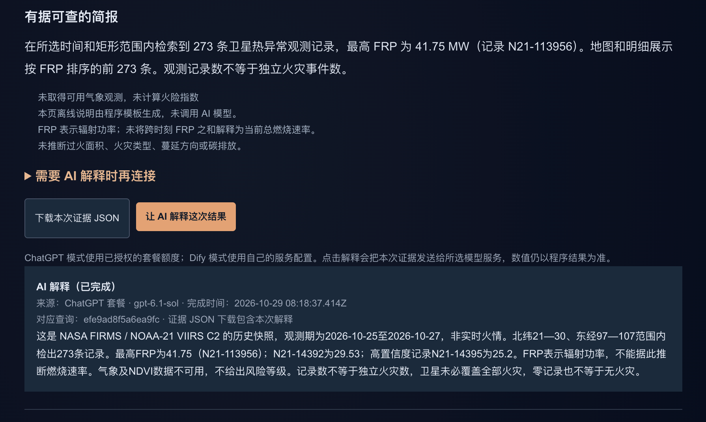

# FireLens 火情循证助手

基于[原FireLens](https://github.com/LeonardoSya/firelens-nextjs)的增量开发：统一查询、卫星观测与记录核对、AI解释、同期模型气象及证据导出。原作者与MIT许可保留，使用生成式AI辅助。



## 下载与运行

本仓库以完整源码ZIP提供。下载[firelens-evidence-source.zip](firelens-evidence-source.zip)并解压，进入firelens-evidence目录后：

```bash
pnpm install --frozen-lockfile --ignore-scripts
node scripts/restore-snapshot.mjs
npm run dev
```

使用Node.js 26与pnpm 9。打开http://localhost:3000/zh/evidence。基础查询与附带云南案例无需账号；AI需使用者自行授权。仓库网址是源码入口，目前没有已验证的线上部署。

## 2026年10月30日更新

已接入Open-Meteo / ECMWF IFS中心点同期历史模型气象。云南默认案例：273条观测，最大FRP 41.75 MW；61个有效温湿风整点样本，均温18.71°C、均湿57.43%、均风速2.58 m/s，窗口内60个完整小时降水合计0.3 mm。真实气象快照随源码保存；其他受支持区域按需联网请求。页面、AI和导出共享气象依据ID。

气象是中心点模型结果，不是气象站实测或区域平均，不生成火险等级。火点仍为2026年10月25至27日历史快照；不是实时预警。原预览图为10月29日真实AI结果，早于本次气象接入。气象数据CC BY 4.0，来源与许可见源码docs/同期气象接入.md及[NOTICE](NOTICE.md)。

## 核查与提交

源码含35项TypeScript测试及8项Python节点测试。2026年10月30日生产构建、气象接口、真实AI和浏览器下载核对通过；[验证记录](verification-records.zip)保留执行时间及适用范围。源码ZIP内的GitHub工作流模板尚不代表此仓库已运行远端CI。

报告、视频和选交佐证PDF在参赛网站单独提交，本仓库不附比赛报告或视频。上游版权见[LICENSE](LICENSE)，来源见[UPSTREAM.json](UPSTREAM.json)。无账号凭据、用户反馈、软著或上游合并记录。
